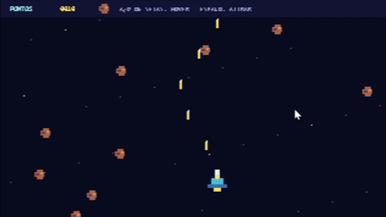

# BYTE QUEST

Um mini jogo de nave e meteoros em pixel art, feito em C++ para Windows com Win32. O menu, a nave, os meteoros, a música chiptune e os efeitos sonoros são desenhados ou gerados pelo próprio código.

## Como jogar

- **A / D** ou **← / →**: mover a nave.
- **Espaço**: atirar.
- Destrua os meteoros para marcar pontos e evite que eles atinjam a nave.
- **Enter**: começar pelo menu ou jogar novamente após o fim.
- **Esc**: voltar ao menu ou sair.
- No menu, selecione **SOM** para ligar ou desligar a música e os efeitos sonoros.

## Como executar

O projeto usa C++20, a API Win32 e o áudio WaveOut do Windows; não precisa baixar bibliotecas ou arquivos de música.

1. Abra `amaisb.slnx` no Visual Studio com o workload **Desenvolvimento para desktop com C++** instalado.
2. Selecione a configuração **Debug** e a plataforma **x64**.
3. Compile e execute com **Ctrl+F5** (ou clique em **Iniciar**).

## Estrutura

- `amaisb/amaisb.cpp`: menu, lógica do jogo, renderização pixelada e áudio.
- `amaisb/`: projeto Visual C++ e recursos do aplicativo.
- `bytequest.gif`: animação de gameplay usada neste README.
